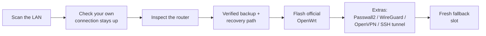

<h1 align="center">▌wrtforge</h1>

<p align="center"><b>Paste one command. Get a clean, official OpenWrt, your choice of Passwall2 / WireGuard / OpenVPN / SSH tunnel, and a recovery slot.</b><br>
A single static binary. No Python, no install. It talks to your router over SSH.</p>

<p align="center">
  <a href="https://github.com/mralinp/wrtforge/actions/workflows/ci.yml"></a>
  <a href="https://github.com/mralinp/wrtforge/releases/latest"></a>
  <a href="https://github.com/mralinp/wrtforge/releases"></a>
  <a href="LICENSE"></a>
  <a href="https://github.com/mralinp/wrtforge/stargazers"></a>
  <br>
  
  
  
  
  
</p>

---

## Why wrtforge

- **One command, nothing to install.** A static binary that scans your network, finds your OpenWrt routers and walks you through it.
- **Safety first.** A verified backup (including Wi-Fi calibration data) and a recovery path come *before* the flash. VPN tunnels are checked and rolled back if they do not come up, so your LAN is never left offline.
- **Official sources only.** Images from `downloads.openwrt.org` checked against their sha256; Passwall2 from its official feeds.
- **Your choice of tunnel.** Passwall2, WireGuard, OpenVPN or an SSH SOCKS tunnel, alone or together.
- **Yours to inspect.** One small Rust program, MIT licensed, with a `--dry-run` that changes nothing.

---

## Quick start

**macOS / Linux**

```bash
curl -fsSL https://raw.githubusercontent.com/mralinp/wrtforge/main/get.sh | sh
```

**Windows** (PowerShell)

```powershell
irm https://raw.githubusercontent.com/mralinp/wrtforge/main/get.ps1 | iex
```

That downloads the latest release for your machine, checks its sha256, and runs it from a temporary folder. Nothing is installed. It scans your networks, lists the OpenWrt routers it finds and asks which one, asks how to log in, shows you the plan, and waits for your OK before touching anything.

Want to look first? Nothing is changed with `--dry-run`:

```bash
curl -fsSL https://raw.githubusercontent.com/mralinp/wrtforge/main/get.sh | sh -s -- 192.168.1.1 --dry-run
```

```powershell
$env:WRTFORGE_ARGS = '192.168.1.1 --dry-run'; irm https://raw.githubusercontent.com/mralinp/wrtforge/main/get.ps1 | iex
```

<sub>Rather not pipe to `sh`? Grab a binary from the [Releases](https://github.com/mralinp/wrtforge/releases) page (Linux and macOS on x86_64 and arm64, Windows on x86_64, each with a `.sha256`), or build it: `cargo install --git https://github.com/mralinp/wrtforge`. Read [get.sh](get.sh) first, it is short.</sub>

## Downloads

Latest release: [**github.com/mralinp/wrtforge/releases/latest**](https://github.com/mralinp/wrtforge/releases/latest). Every file has a matching `.sha256`.

| Platform | Architecture | Download |
|---|---|---|
| Linux (static) | x86_64 | [`wrtforge-x86_64-unknown-linux-musl.tar.gz`](https://github.com/mralinp/wrtforge/releases/latest/download/wrtforge-x86_64-unknown-linux-musl.tar.gz) |
| Linux (static) | arm64 | [`wrtforge-aarch64-unknown-linux-musl.tar.gz`](https://github.com/mralinp/wrtforge/releases/latest/download/wrtforge-aarch64-unknown-linux-musl.tar.gz) |
| macOS | Apple Silicon | [`wrtforge-aarch64-apple-darwin.tar.gz`](https://github.com/mralinp/wrtforge/releases/latest/download/wrtforge-aarch64-apple-darwin.tar.gz) |
| macOS | Intel | [`wrtforge-x86_64-apple-darwin.tar.gz`](https://github.com/mralinp/wrtforge/releases/latest/download/wrtforge-x86_64-apple-darwin.tar.gz) |
| Windows | x86_64 | [`wrtforge-x86_64-pc-windows-msvc.zip`](https://github.com/mralinp/wrtforge/releases/latest/download/wrtforge-x86_64-pc-windows-msvc.zip) |

Unpack it and run `./wrtforge` (`wrtforge.exe` on Windows). Verify with `shasum -a 256 -c wrtforge-*.sha256`.

## How it works



## Stay online while it works

Connect your laptop to the router with a **LAN cable**, and keep **Wi-Fi (or any other connection) as your main internet**. The router can then reboot as often as it likes and you never lose your connection. wrtforge checks this first and warns you if your internet currently runs through the router being flashed.

## What you get

| Step | What happens |
|---|---|
| **Discovery** | Scans your local networks for OpenWrt routers (LuCI page or dropbear SSH) and lets you pick one. Or pass the address, or `--no-scan` to type it. |
| **Network check** | Tells you whether the flash would cut your own internet, and how to avoid it. |
| **Inspect** | Detects your exact board and OpenWrt target over SSH. |
| **Backup & recovery** | *Before* anything is flashed: saves your config, package list, and the bootloader and Wi-Fi calibration partitions to `~/wrtforge-backups/` (every partition verified by hash). Dual-slot devices keep the old firmware as the recovery path; single-slot devices also get the official factory image saved for USB/TFTP recovery. |
| **Flash** | Downloads the latest stable official image for that board, verifies its sha256, runs `sysupgrade`. |
| **Keep** | Carries over only what you choose: SSH keys, root password, optionally LAN/Wi-Fi/DHCP and your Passwall2 config. |
| **Extras** | Pick any of **Passwall2**, **WireGuard**, **OpenVPN** and an **SSH tunnel** (see below). Passwall2 is the default; the rest are opt-in. |
| **Benchmark** | From the menu or `--bench`: measures speed and router CPU on the router itself. A full-potential mode (`bench/`) pushes `iperf3` through Passwall2 to find the router's real ceiling, per cipher. See [Benchmark](#benchmark). |
| **Recovery slot** | Once the new system works, replaces the old firmware in the second slot with the official image, verified by hash. |

```
  ▌wrtforge  v0.1.0

  ✔ Found 2 OpenWrt routers
  ? Which router should I set up?
  ❯ 192.168.1.1  OpenWrt (LuCI)  ← your gateway
    192.168.1.2  likely OpenWrt (dropbear SSH)
    Enter an address manually

  Network
  ✔ two networks: router via en5, internet via en0. You will stay online.

  Inspect
  ✔ Linksys MX5300 (linksys,mx5300)
  ✔ OpenWrt 25.12.5  openwrt-…-sysupgrade.bin, 13.8 MB

  Backup & recovery
  ✔ Backup verified (~/wrtforge-backups/linksys_mx5300-…, 23 flash partitions)
  ✔ Downloaded and verified sha256 1d8895048d5a…

  Flash
  ✔ Image accepted by sysupgrade; flashing and rebooting
  ✔ Router is back

  Extras
  ✔ WireGuard is up, handshake verified
  ✔ Passwall2 installed and running

  Recovery slot
  ✔ Fallback slot ready (alt_kernel, verified by hash)
```

## Logging in

| Choice | Behaviour |
|---|---|
| **key** | Uses a key the router already trusts. |
| **password** | `ssh` asks for the password itself. wrtforge never sees or stores it. |
| **copy-key** | Type the password once; wrtforge installs your public key so the rest runs without prompts. |

## Options

```
wrtforge [HOST] [--no-scan] [-u USER] [-p PORT] [--auth key|password|copy-key]
         [--release 25.12.5] [--with passwall2,wireguard,openvpn,ssh-tunnel|none]
         [--wireguard-conf FILE] [--openvpn-conf FILE]
         [--ssh-tunnel USER@HOST[:PORT]] [--tunnel-lan]
         [--no-fallback] [--backup-dir DIR] [--dry-run] [-y [--go]]
```

`-y` accepts every default, handy for scripts. Pass the address and `--auth` with it. The final "flash now?" still needs a real yes, so scripts add `--go`.

## Extras: Passwall2, WireGuard, OpenVPN, SSH tunnel

Asked as a multi-select (or `--with passwall2,wireguard,...`; `--with none` for a plain OpenWrt). Anything that needs a file or a server is read and checked **before** the router is flashed.

| Extra | What it does |
|---|---|
| **Passwall2** | Official feeds, `dnsmasq-full` and the dependencies Passwall2 forgets (xray-core, tproxy modules…). |
| **WireGuard** | Installs `wireguard-tools` + LuCI support. With `--wireguard-conf client.conf` it creates the interface and peers, puts it in the `wan` firewall zone, and waits for a handshake. **If there is none within 25 s it rolls everything back**, so a bad config cannot leave your LAN offline. |
| **OpenVPN** | Installs `openvpn-openssl` + LuCI support. With `--openvpn-conf profile.ovpn` it creates the `tun0` interface, starts the client and waits for the tunnel; rolls back if it does not come up. Profiles that ask for a username/password need a credentials file, and wrtforge warns you. |
| **SSH tunnel** | Installs `sshtunnel` + the OpenSSH client, creates a key on the router, optionally authorizes it on your server from your laptop, and runs a SOCKS5 proxy on port 1080 (`--tunnel-lan` shares it with the LAN; otherwise only the router can use it, e.g. as a SOCKS node in Passwall2). |

Without a file or server, an extra is only installed and you finish it in LuCI. Your keys and configs travel over SSH only and are never printed. Combining a full-tunnel VPN (`AllowedIPs = 0.0.0.0/0`) with Passwall2 makes both fight over the default route; pick one for the whole LAN.

## Benchmark

Two tools, for two questions.

### Quick speed check (menu or `--bench`)

Pick **Benchmark** in the menu that appears after you choose the router, or skip the menu:

```bash
wrtforge 192.168.1.1 --bench
```

It runs the test **on the router** over SSH (its own `uclient-fetch` against Cloudflare's public speed endpoints; nothing is installed). It measures download, upload and HTTPS latency, samples the router's CPU during each transfer, and prints a markdown row. Results are appended to `wrtforge-bench.csv` (`--bench-out`). The run is named `<board>-<active tunnel>` (passwall2, wireguard, openvpn or none); `--label` overrides it. `--rounds` (default 3) and `--secs` (default 10) set the median and transfer length. This measures your real connection, so a slow proxy node or ISP shows up in it. Router-originated traffic only goes through Passwall2 if its "localhost proxy" option is on.

### Full-potential benchmark (`bench/`)

Use this to find what the router itself can do, with no VPS, Cloudflare or ISP in the path: a local Xray server, `iperf3 -P 8` pushed *through* the router's Passwall2, and per-core router CPU. Results from real routers: [Google WiFi (Gale)](reports/gale.md) and [Linksys MX5300](reports/mx5300.md).

What you need:
- `xray` and `iperf3` on your machine (`brew install xray iperf3`), plus SSH key access to the router as root.
- **A gigabit Ethernet adapter.** A 100 Mbps one ends every test at about 94 Mbps and hides what the router can do (the reports above hit exactly this).
- Cabling: the router's WAN to the network your server sits on; your machine on that network as the **server**, and a LAN cable (or Wi-Fi) from your machine to the router as the **client**. A second machine as the server also enables the plain-NAT baseline.
- Put the cable you use for the client first in your network service order (macOS: System Settings, Network, Set Service Order), or `run.sh` stops with an explanation. If both the cable and Wi-Fi are on the router's network, route the test address through the router.

What to do:

```bash
bench/server.sh 192.168.70.50                       # your IP on the router's WAN side; leave it running
bench/run.sh 192.168.1.1 bench-server/params.env    # router LAN IP; default 30 s x 3 reps x all scenarios
```

Optional arguments: `bench/run.sh <router> <params.env> [secs] [reps] [scenarios...]`, with scenarios `nat`, `vless-tcp`, `vless-tls`, `ss-aes`, `ss-chacha`. Results go to `wrtforge-bench.csv` (`BENCH_OUT` changes it). The router's Passwall2 config is backed up to `/root/passwall2.bench-backup` first and restored on exit, including on Ctrl-C; delete the backup afterwards if you do not want a second copy of your config on the router. Stop the server with Ctrl-C.

How to read it:
- If throughput **plateaus while no core is near 100%**, the bottleneck is your adapter, cable or Wi-Fi, not the router.
- If a core is at **90% or more**, that number is the router's ceiling for that tunnel. Compare ciphers: routers without AES instructions (older ARMv7 such as the Gale) are much faster with ChaCha20.
- To guess a ceiling you could not reach, scale: `measured speed x 95 / busiest-core CPU %`. It is a rough, straight-line estimate; report it as an estimate, never as a measurement.

## Backups

Each run writes `~/wrtforge-backups/<board>-<time>/` with `config-backup.tar.gz`, `device-info.txt` (release, partition table, package list) and raw copies of the small flash partitions (bootloader, U-Boot env, Wi-Fi calibration `art`). That calibration data cannot be recreated if lost. **The folder contains your Wi-Fi passwords and keys**, so it is created private (`700`); keep it that way.

## Google Wifi (Gale) and other single-slot devices

wrtforge works on a router that already runs OpenWrt. The Google Wifi ships with ChromeOS-based firmware, so its **first** OpenWrt install is a one-time USB-boot procedure from the [OpenWrt Google Wifi page](https://openwrt.org/toh/google/wifi). After that, wrtforge handles upgrades and Passwall2. It has a single eMMC firmware slot, so there is no second slot to fall back on: the recovery path is the backup plus the official factory image, which wrtforge saves next to it for re-doing the USB recovery. Not yet tested on Gale hardware.

## Needs

- A router that already runs OpenWrt (any build, rebrands such as PeDitXOS included) and can reach the internet.
- `ssh` on your laptop: macOS, Linux, or Windows 10/11 (the OpenSSH client is built in).
- On Windows the OpenSSH client cannot share a connection, so with `password` or `copy-key` wrtforge installs your SSH key with the one password prompt and uses the key from then on. The "is my internet going through this router" check is skipped there.

## Good to know

- Your Passwall2 nodes, VPN keys and profiles are not in this repo. They only move from the router's own `/etc/config/passwall2` to the new firmware, and only if you say yes.
- Expect the router to be offline for about 5 to 15 minutes. The old settings are not kept except what you chose.
- Host keys are trusted on first contact each run, which is fine on a LAN you control.
- Image selection, backup and Passwall2 are generic. The second-slot writer knows the Linksys MX layout (`alt_kernel` / `alt_rootfs`) and is skipped on other devices.
- Built from a manual migration of a Linksys MX5300 (PeDitXOS 24.10 to OpenWrt 25.12.5). Parts were re-checked on that router, but a full one-shot run is not yet verified. Run `--dry-run` first. A flash can brick a device; use at your own risk.

<details>
<summary>Lessons baked in (why it does things this way)</summary>

- The keep-bundle is built **on the router**. Built on macOS, the files carry your uid and dropbear rejects `authorized_keys`, locking you out.
- Passwall2's dependencies go in **before** the app. A restored, enabled config starts at once, and with xray missing its half-loaded nft rules cut your internet.
- The legacy values `tcp_no_redir_ports 'disable'` and `udp_no_redir_ports 'disable'` break the new nft rules, so they are removed.
- Every `sysupgrade` swaps slots and drops installed packages. Settings stay, packages do not.
- On the MX5300 the 150 MB `syscfg` partition is read-only in the stock device tree, so it cannot be used as storage without a custom kernel.

</details>

## Contributing

Every task is an issue (with labels), a branch off `main`, and a PR into `main`; merging to `main` bumps the version and publishes a release with a changelog from the PR titles. The rules are in [CLAUDE.md](CLAUDE.md).

```bash
cargo fmt --all && cargo clippy --all-targets -- -D warnings && cargo test
WRTFORGE_TEST_HOST=192.168.1.1 cargo test -- --ignored   # live backup test, needs a router
```

MIT licensed.
