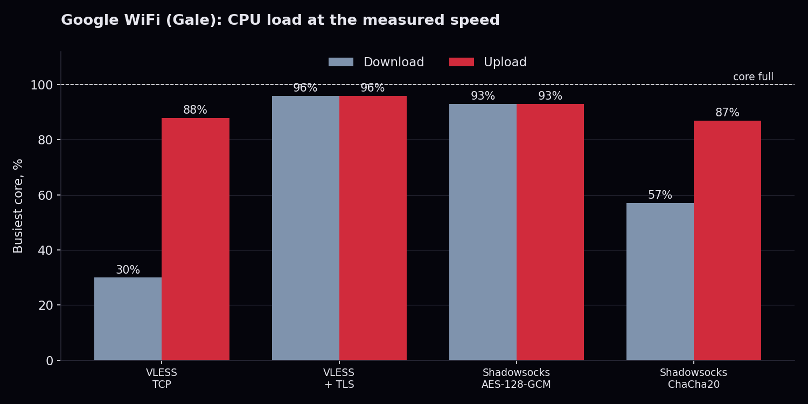
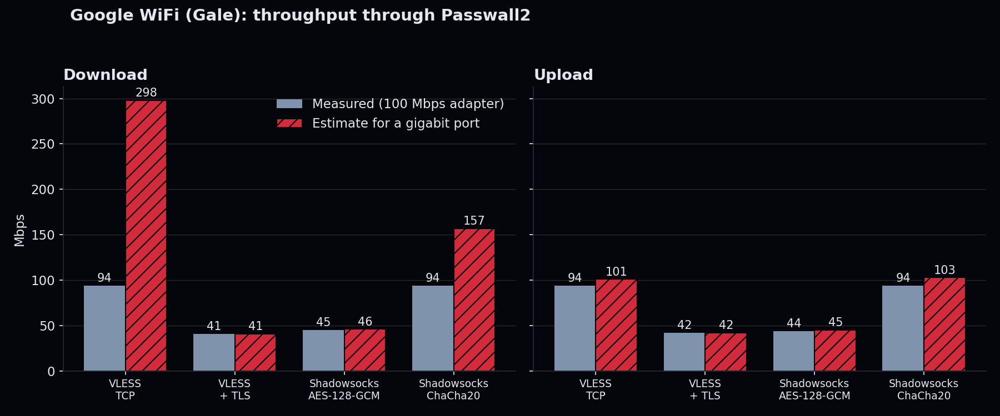

# Benchmark report: Google WiFi (Gale)

Google WiFi (Gale, AC-1304), IPQ4019, 4x Cortex-A7, 512 MB. OpenWrt 25.12.5 (r33051), Passwall2 with Xray.
Raw data: [gale.csv](gale.csv). Method: [README, Benchmark](../README.md#benchmark).

## Setup

A local Xray server and iperf3 on a laptop on the router's WAN side; the same laptop on a LAN cable as the client. `iperf3 -P 8`, 20 s per direction, 3 repetitions, median. Router CPU read per core from `/proc/stat` during each run. The laptop's wired adapter was 100 Mbps, so any result near 94 Mbps means the adapter ended the test, not the router.

## Results

| Tunnel | Down | Up | Busiest core (down / up) |
|---|---|---|---|
| VLESS over TCP, no encryption | 94 Mbps | 94 Mbps | 30% / 88% |
| VLESS with TLS | 41 Mbps | 42 Mbps | 96% / 96% |
| Shadowsocks, AES-128-GCM | 45 Mbps | 44 Mbps | 93% / 93% |
| Shadowsocks, ChaCha20-Poly1305 | 94 Mbps | 94 Mbps | 57% / 87% |

## Estimate for a gigabit port (not measured)

`estimate = measured speed x 95 / busiest-core CPU %`

A straight-line guess from the CPU left over, with 95 instead of 100 because the last few percent of a core is not usable. Applied to all four tests; the two already CPU-bound barely move. Treat it as an order of magnitude.

| Tunnel | Down measured | Down estimate | Up measured | Up estimate |
|---|---|---|---|---|
| VLESS over TCP | 94 | about 300 | 94 | about 100 |
| VLESS with TLS | 41 | about 41 | 42 | about 42 |
| Shadowsocks AES-128-GCM | 45 | about 46 | 44 | about 45 |
| Shadowsocks ChaCha20 | 94 | about 160 | 94 | about 100 |

## Reading it

Encryption is the limit, not the ports or the radio. With TLS or AES the CPU is at 93 to 96% and speed stops near 41 to 45 Mbps. ChaCha20 reaches the adapter's limit on the same router with CPU to spare on download. A Cortex-A7 is an older ARMv7 core without AES instructions, which fits AES being slow in software. Upload is the weak direction: it already used 87 to 88% of a core at 94 Mbps, so do not expect much more than 100 Mbps there.
