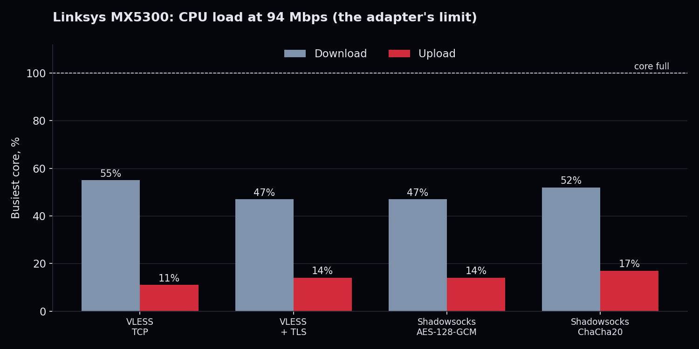
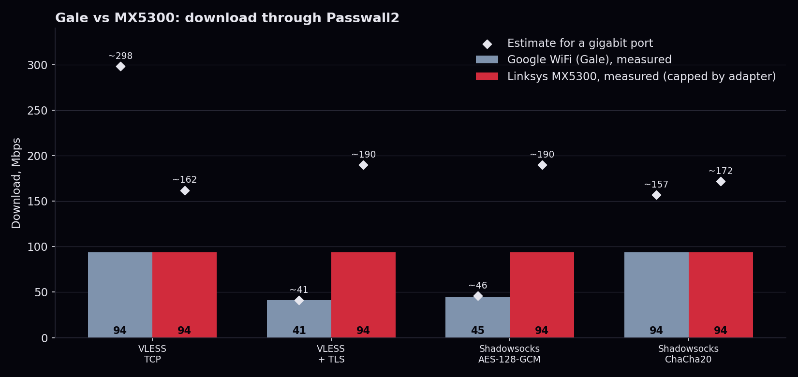

# Benchmark report: Linksys MX5300

Linksys MX5300 (Velop), IPQ8072A, 4x Cortex-A53, 1 GB. OpenWrt 25.12.5, Passwall2 with Xray.
Raw data: [mx5300.csv](mx5300.csv). Method: [README, Benchmark](../README.md#benchmark).

## Setup

Same method as the [Gale report](gale.md), with one difference: the client was on the router's **Wi-Fi** and the Xray server on a 100 Mbps cable on the router's WAN side. Part of the CPU measured here is therefore the Wi-Fi radio, not only the tunnel. The 100 Mbps cable ended every test.

## Results

| Tunnel | Down | Up | Busiest core (down / up) | Down estimate, gigabit |
|---|---|---|---|---|
| VLESS over TCP, no encryption | 94 Mbps | 94 Mbps | 55% / 11% | about 160 Mbps |
| VLESS with TLS | 94 Mbps | 94 Mbps | 47% / 14% | about 190 Mbps |
| Shadowsocks, AES-128-GCM | 94 Mbps | 93 Mbps | 47% / 14% | about 190 Mbps |
| Shadowsocks, ChaCha20-Poly1305 | 94 Mbps | 93 Mbps | 52% / 17% | about 170 Mbps |

The estimate uses the same formula as the Gale (`measured x 95 / busiest-core CPU %`), download only. Upload is not estimated: at 11 to 17% of a core the scaling would claim 500 Mbps or more, which the data cannot support. Because the radio is part of the CPU load, the true tunnel limit is probably higher than these numbers. Read every figure here as a floor.

## Compared with the Gale

The cipher does not matter on the MX5300: TLS and AES cost almost nothing extra, and the CPU sits near half-loaded at 94 Mbps. On the tests where the Gale falls to 41 to 45 Mbps, the MX5300 is at least 2.3 times faster and still not working hard. Its Cortex-A53 cores report `aes pmull sha1 sha2` in `/proc/cpuinfo`.
